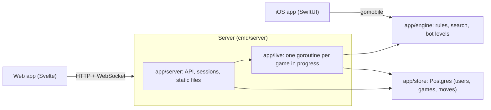

# chess

Real-time chess: play a friend online, play the engine, or pass and play on one
device. A Go server with a bitboard engine, a Svelte web app, and a native iOS
app that runs the same engine on the phone.



- **Games are their moves.** The database stores each game's seats, result and
  move list; every position is derived by replaying moves. There is no stored
  board to drift out of step.
- **One goroutine owns each live game.** Moves for a game are applied in order
  by its room, which writes them to Postgres and then sends them to everyone
  watching. No locks, no cache.
- **One engine everywhere.** `engine.Game` is the only place the rules live; the
  server, the UCI binary and the iOS app all use it.

See [docs/architecture.md](docs/architecture.md) for the details and
[docs/protocol.md](docs/protocol.md) for the API and WebSocket messages.

See [ROADMAP.md](ROADMAP.md) for what is planned next, starting with puzzle
mode in Calm Chess.

## Running it

```sh
make test                      # Go tests, including end-to-end socket tests
DATABASE_URL=postgres:///chess?host=/tmp make run
cd web && npm run dev          # web app with hot reload, proxied to :9000
```

`docker compose up` runs the server and Postgres together.

## UCI engine

The bitboard engine can also be driven over the [Universal Chess Interface
(UCI)](https://www.chessprogramming.org/UCI) protocol, so it plugs into standard
GUIs and test tooling (Cute Chess, Arena, Banksia) and can be matched against
other engines.

```sh
go build -o bin/uci ./cmd/uci    # or: make uci
./bin/uci
```

Example session:

```
uci
position startpos moves e2e4 e7e5
go movetime 1000
# -> info depth ... ; bestmove ...
quit
```

Supported commands: `uci`, `isready`, `ucinewgame`, `setoption`,
`position [startpos | fen <FEN>] [moves ...]`, `go` (`depth`, `movetime`,
`wtime`/`btime`/`winc`/`binc`/`movestogo`, `infinite`), `stop`, `quit`. Moves use
UCI long algebraic notation with promotion suffixes (e.g. `e7e8q`, `e7e8n`).

The search sees threefold repetition (from the `position ... moves` history)
and the fifty-move rule, so it avoids throwing away a won position.

---
